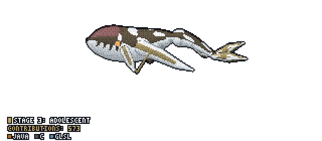

# Dev Borah

**Known as bitzzdev | bitz.dev | Software developer and open source creator | Assam, India**

I build software across web platforms, systems programming, and developer tooling.

<div align="center">

[](https://bitz.is-a.dev)
[](https://github.com/bitzzdev)
[](https://gitlab.com/bitzzdev)
[](https://ko-fi.com/bitzzdev)
[](https://www.reddit.com/user/bitzzdev/)
[](https://www.linkedin.com/in/bitzzdev/)
[](https://x.com/bitzzdev)
[](https://instagram.com/bitz.dev)
[](https://www.youtube.com/@bitzzzdev)
[](https://orcid.org/0009-0004-2013-2999)

</div>

## Now

I am working with [XEH (XEHhq)](https://xeh.devs.surf) as founder and lead developer. XEH is an independent open-source engineering organization building Linux tools, developer utilities, frontend systems, and practical software, kept open so people can read it, fork it, and improve it.

Team: Abhilasha Ray (marketing head), Biswajit Tanti (product lead and developer), and Dev Borah (founder and lead developer). Products: [DEVdots](https://gitlab.com/xehhq/DEVdots), a riced Arch Linux and Hyprland desktop UI in early development, and [XEHkit](https://gitlab.com/xehhq/XEHkit), a Next.js component library. Full dossier: [bitz.is-a.dev/xeh](https://bitz.is-a.dev/xeh).

---

## About

I am Dev Borah (legal identity Bitupan Borah), an independent software developer and systems creator from Lakhimpur, Assam, India. Online I build under the monikers bitzzdev and bitz.dev.

My work centers on writing reliable, fast software: native Linux utilities, Wayland desktop components, low-latency web platforms, and graphics shaders.

Primary domains: Full-stack web platforms, cloud infrastructure (Azure VPS, Firebase), systems programming in Rust and C, Linux desktop ricing (Hyprland), Android utilities, and Minecraft graphics/performance mods.

## Technologies

<div align="center">


</div>

## Open source repositories

### Systems and Linux tooling

- **DEVos** ([GitHub](https://github.com/bitzzdev/DEVos) | [GitLab](https://gitlab.com/bitzzdev/DEVos)): Early native Linux research and userspace implementation for the Realme C11 2021 (RMX3231), covering kernel analysis, boot/initramfs workflows, and pocket-server architecture.
- **quickShelf** ([GitHub](https://github.com/bitzzdev/quickShelf) | [GitLab](https://gitlab.com/bitzzdev/quickShelf)): Rust-based Wayland desktop widget and Waybar popover for pinned app shortcuts, image drop previews, and quick access to media controls and launcher actions.
- **devSubstrate** ([GitHub](https://github.com/bitzzdev/devSubstrate) | [GitLab](https://gitlab.com/bitzzdev/devSubstrate)): A research substrate for modern software engineering: AI API architectures, terminal-native agents, and OS repair notes.
- **cloudMux** ([GitHub](https://github.com/bitzzdev/cloudMux) | [GitLab](https://gitlab.com/bitzzdev/cloudMux)): Cross-shell GitHub, Google Cloud, and Azure CLI shortcuts for Termux and desktop Linux.
- **tools** ([GitHub](https://github.com/bitzzdev/tools) | [GitLab](https://gitlab.com/bitzzdev/tools)): Developer utilities, automation scripts, and productivity tools for Linux and cloud environments.
- **oha** ([GitHub](https://github.com/bitzzdev/oha) | [GitLab](https://gitlab.com/bitzzdev/oha)): Terminal-based fullscreen text editor written in C with syntax highlighting and built-in file browsing.
- **tiv** ([GitHub](https://github.com/bitzzdev/tiv) | [GitLab](https://gitlab.com/bitzzdev/tiv)): Lightweight GTK image viewer for Linux with keyboard navigation.

### Desktop customization

- **bitzdots** ([GitHub](https://github.com/bitzzdev/bitzdots) | [GitLab](https://gitlab.com/bitzzdev/bitzdots)): Lean Arch Linux Hyprland dotfiles with automatic matugen theming, low-end hardware optimization, and customized Waybar modules.
- **hyprConfig** ([GitHub](https://github.com/bitzzdev/hyprConfig) | [GitLab](https://gitlab.com/bitzzdev/hyprConfig)): E-ink themed Hyprland dotfiles with Quickshell top bar and dynamic palette generation.
- **phoneWallpapers** ([GitHub](https://github.com/bitzzdev/phoneWallpapers) | [GitLab](https://gitlab.com/bitzzdev/phoneWallpapers)): Curated collection of high-resolution 2K portrait phone wallpapers and anime mobile backgrounds.

### Mobile applications

- **devLauncher** ([GitHub](https://github.com/bitzzdev/devLauncher) | [GitLab](https://gitlab.com/bitzzdev/devLauncher)): Minimal launcher for Android focused on keyboard-driven navigation, fast app launching, and reduced screen distractions.

### Minecraft mods and shaders

- **Pulse** ([GitHub](https://github.com/bitzzdev/Pulse) | [GitLab](https://gitlab.com/bitzzdev/Pulse)): Adaptive Performance Manager for Minecraft that monitors rendering performance and dynamically adjusts visual quality.
- **RealisticallyOptimized** ([GitHub](https://github.com/bitzzdev/RealisticallyOptimized) | [GitLab](https://gitlab.com/bitzzdev/RealisticallyOptimized)): Stylized toon-lighting Minecraft shaderpack with real-time shadows, optimized for performance.
- **JustVanilla** ([GitHub](https://github.com/bitzzdev/JustVanilla) | [GitLab](https://gitlab.com/bitzzdev/JustVanilla)): Vanilla-enhancing Minecraft shaderpack with real-time shadows, optimized for all hardware.
- **byeByeFallingLeaves** ([GitHub](https://github.com/bitzzdev/byeByeFallingLeaves) | [GitLab](https://gitlab.com/bitzzdev/byeByeFallingLeaves)): Minecraft resource pack that removes all falling leaf and cherry blossom particles for cleaner visuals.
- **NexUI** ([GitHub](https://github.com/bitzzdev/NexUI) | [GitLab](https://gitlab.com/bitzzdev/NexUI)): Client-side HUD interface editor and modern design studio for Minecraft.
- **MineGPT** ([GitHub](https://github.com/bitzzdev/MineGPT) | [GitLab](https://gitlab.com/bitzzdev/MineGPT)): In-game AI chat assistant for Minecraft supporting OpenAI, Anthropic, Gemini, and OpenRouter.
- **CustomPaintings** ([GitHub](https://github.com/bitzzdev/CustomPaintings) | [GitLab](https://gitlab.com/bitzzdev/CustomPaintings)): Minecraft Paper plugin for uploading PNGs and creating map-based paintings, including multi-map murals.
- **stasis** ([GitHub](https://github.com/bitzzdev/stasis) | [GitLab](https://gitlab.com/bitzzdev/stasis)): Fabric server-side Minecraft mod that reduces BlockEntity tick load with activity-aware scheduling.
- **cartoonee** ([GitHub](https://github.com/bitzzdev/cartoonee) | [GitLab](https://gitlab.com/bitzzdev/cartoonee)): Minecraft texture pack redesigning swords in a cartoon style while preserving vanilla aesthetic.

### AI agent tooling

- **skills** ([GitHub](https://github.com/bitzzdev/skills) | [GitLab](https://gitlab.com/bitzzdev/skills)): Production-ready agent skills, automation recipes, and developer workflows for AI coding assistants.

[Browse all public repositories on GitHub](https://github.com/bitzzdev?tab=repositories) | [Browse all public repositories on GitLab](https://gitlab.com/bitzzdev) | [Browse in the portfolio explorer](https://bitz.is-a.dev/repos)

The portfolio ships an in-site repository browser at [bitz.is-a.dev/repos](https://bitz.is-a.dev/repos). It lists every public repository with name, description, and tags, and clicking any repository opens its README, file tree, file contents, commit history, branches, and tags without leaving the site. Data is served live from GitHub with an automatic fallback to the GitLab mirror.

## Activity

<p align="center">
  <a href="https://github.com/PramudithaN/git-tulkun">
    
  </a>
  <br />
  <em>Procedural activity banner generated by git-tulkun</em>
</p>

<div align="center">

[](https://github.com/bitzzdev?tab=followers)
[](https://github.com/bitzzdev?tab=repositories)
[](https://github.com/bitzzdev)

</div>

## Local setup and development

### Installation

Clone the repository and install dependencies:

GitHub:

```bash
git clone https://github.com/bitzzdev/bitzzdev.git
cd bitzzdev
npm install
```

GitLab:

```bash
git clone https://gitlab.com/bitzzdev/bitzzdev.git
cd bitzzdev
npm install
```

### Usage and development server

Start the Next.js development server:

```bash
npm run dev
```

Open `http://localhost:3000` in your browser.

To build the static and production assets:

```bash
npm run build
```

## Connect and profiles

For contract inquiries, open-source collaboration, or consulting:

- Website: [bitz.is-a.dev](https://bitz.is-a.dev)
- GitHub: [github.com/bitzzdev](https://github.com/bitzzdev)
- GitLab: [gitlab.com/bitzzdev](https://gitlab.com/bitzzdev)
- Ko-fi: [ko-fi.com/bitzzdev](https://ko-fi.com/bitzzdev)
- Reddit: [reddit.com/user/bitzzdev](https://www.reddit.com/user/bitzzdev/)
- LinkedIn: [linkedin.com/in/bitzzdev](https://www.linkedin.com/in/bitzzdev/)
- X: [x.com/bitzzdev](https://x.com/bitzzdev)
- Instagram: [instagram.com/bitz.dev](https://instagram.com/bitz.dev)
- YouTube: [youtube.com/@bitzzzdev](https://www.youtube.com/@bitzzzdev)
- Email: bitzzdev@gmail.com
- ORCID: [orcid.org/0009-0004-2013-2999](https://orcid.org/0009-0004-2013-2999)
